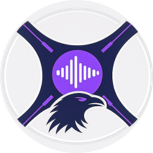

<div align="center">
  
  <h1>Themarr</h1>
  <p><strong>Theme song manager for Jellyfin libraries.</strong><br />
  Find a theme on YouTube, trim it, level its loudness, tag it and drop it in the right folder, for the whole show or for each season.</p>

  <a href="https://github.com/PedroRomeu/Themarr/releases/latest"></a>
  <a href="LICENSE"></a>
  
  
</div>

## About

Jellyfin plays a theme song while you browse a series or movie, as long as the media folder has a
`theme.mp3` or a `theme-music/` folder. Themarr is a web app that builds those files for you.

You pick the music. Themarr searches YouTube, lets you preview and cut the exact part you want, normalizes the
volume so every show plays at the same level, embeds the cover and the official title from Jellyfin, and saves
the file where Jellyfin expects it. Shows with a different opening per season get one theme per season folder.

It runs as a Windows desktop app or as a Docker container next to your Jellyfin server, with a button on
Jellyfin's own pages that opens the current series or movie in Themarr.

> [!NOTE]
> Looking for fully automatic themes from a shared database? See
> [Themerr](https://github.com/LizardByte/Themerr). Themarr is the hands-on alternative: you choose each track,
> which suits anime, multiple openings and seasons with their own theme.

## Features

**Finding and downloading**
- YouTube search inside the app, with thumbnails, duration and an embedded preview.
- A download queue: name each track, choose its destination (main theme or a season), reorder by dragging,
  retry only the items that failed.
- Precise trimming with start and end times and a live audio preview before anything is downloaded.

**Audio**
- Loudness normalization with FFmpeg `loudnorm` (default target -24 LUFS, adjustable), so themes do not jump
  in volume from one show to the next.
- Optional fade-in, fade-out and removal of leading silence, globally or per track.
- Output is MP3 at 320 kbps.

**Metadata**
- ID3 tags with the track title, the official series or movie name and its genres from Jellyfin.
- Embedded cover art: a local `poster`/`folder`/`cover` image if present, otherwise the Jellyfin poster, or the
  season poster for season themes.

**Library**
- Library Manager: every theme in your library in one place, with preview, rename, trim, re-normalize, re-tag
  and delete, per track or for a whole folder at once.
- Theme Assistant: lists the media with no theme yet and suggests the top YouTube results for each one.
- Organize: creates a season folder and moves loose episode and subtitle files into it, never overwriting
  anything.
- Backup and restore of all your themes as a single `.zip`.

**Jellyfin integration**
- Folders are matched to Jellyfin items by path, with name search as a fallback.
- Jellyfin rescans the media after new themes are saved, so they show up without a manual scan.
- A Themarr button on series, season, episode and movie pages (through the
  [JavaScript Injector](https://github.com/n00bcodr/Jellyfin-JavaScript-Injector) plugin), which Themarr can
  install for you.
- In server mode, sign-in uses Jellyfin administrator accounts. No separate user list.

## What Themarr writes

Only theme files, in the layout Jellyfin reads:

```
Frieren/
├── theme.mp3                     <- one main theme
├── theme-music/                  <- or several main themes
│   ├── Opening 1.mp3
│   └── Opening 2.mp3
└── Season 2/
    └── theme-music/
        └── Opening.mp3           <- theme for that season
```

In server mode a safety guard enforces this: Themarr can only create, rename or delete `theme.mp3` and
`theme-music/*.mp3` files inside existing media folders, and never replaces an existing file when it moves
something. The rest of the library is read only.

## Installation

### Server (Docker)

The recommended setup for a home server. Themarr runs as a container on the same machine as Jellyfin and is
reached from your browser on port 8686.

```bash
git clone https://github.com/PedroRomeu/Themarr.git themarr && cd themarr
cp env.example .env      # set MEDIA_PATH and JELLYFIN_API_KEY
docker compose up -d --build
```

The full guide, including folder layout, permissions and the Jellyfin buttons, is in
**[docs/SERVER.md](docs/SERVER.md)**.

> [!WARNING]
> Themarr is meant for your home network or a private VPN such as Tailscale. Do not expose it to the internet.

### Desktop (Windows)

1. Download `Themarr_vX.Y.Z.zip` from the [latest release](https://github.com/PedroRomeu/Themarr/releases/latest).
2. Extract it anywhere and run `Themarr_Desktop.exe`, which opens Themarr in its own window.
   `Themarr_Server.exe` does the same from a tray icon and opens it in your browser instead.

FFmpeg is bundled. The desktop app listens on `127.0.0.1:5000` only and has no login.

### From source

Python 3.13 or newer, FFmpeg (`bin/ffmpeg.exe` on Windows, `ffmpeg` on the PATH elsewhere) and Node.js or Deno,
which yt-dlp needs for YouTube.

```bash
pip install -r requirements-server.txt "yt-dlp[default]" pywebview pystray pillow
python main.py
```

## Quick start

1. In Jellyfin, open your user settings, go to **Display** and enable **Theme songs**.
2. Open Themarr. In **Settings**, enter your Jellyfin URL and an API key (Dashboard, API Keys) and test the
   connection. The Docker setup reads both from `.env`.
3. Select a media folder, search for its opening, trim it if needed and click **Add** to queue it.
4. Click **Start Processing**. When it finishes, open the series in Jellyfin and the theme plays.

## Requirements

- Jellyfin 10.10. Tested on 10.10.7. Themarr itself only uses the standard Jellyfin API; the page buttons depend
  on the web UI and may need changes on later versions.
- For the buttons: the JavaScript Injector plugin (tested with 3.5.0.0).
- An administrator API key, needed for library rescans and for installing the buttons.
- Media organized the usual Jellyfin way: one folder per series or movie, inside a folder per library.

## Roadmap

- [ ] Import a whole YouTube playlist into the queue.
- [ ] Crossfades and more audio effects.
- [ ] Desktop builds for Linux and macOS.

Ideas and bug reports are welcome in [Issues](https://github.com/PedroRomeu/Themarr/issues).

## Built with

[yt-dlp](https://github.com/yt-dlp/yt-dlp) for search and download, [FFmpeg](https://ffmpeg.org) for audio
processing, [Mutagen](https://github.com/quodlibet/mutagen) for tags, [Flask](https://flask.palletsprojects.com)
and [Waitress](https://github.com/Pylons/waitress) for the web server, and
[pywebview](https://github.com/r0x0r/pywebview) for the desktop window.

## License

Themarr is free software under the [GNU General Public License v3.0](LICENSE).

Themarr is not affiliated with or endorsed by the Jellyfin project or YouTube. You are responsible for making
sure your use of downloaded audio complies with its terms and with the copyright laws where you live.
